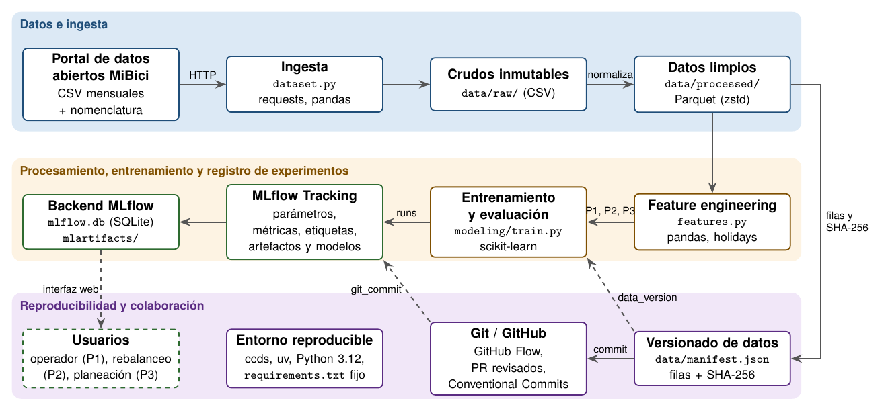

# TC5061 Proyecto MiBici, Equipo NN

<a target="_blank" href="https://cookiecutter-data-science.drivendata.org/">
    
</a>

Proyecto integrador del curso TC5061 Operaciones de Aprendizaje Automático (MLOps), Tec de Monterrey.
Propone y valida una solución de Machine Learning para la operación de MiBici, el sistema de bicicleta
pública del Área Metropolitana de Guadalajara, sobre una base de datos reproducible y versionada.

## Preguntas del proyecto

| # | Pregunta | Tarea | Formulación | Usuario |
|---|----------|-------|-------------|---------|
| P1 | ¿Cuántos viajes se iniciarán en una estación o zona en un periodo futuro? | Regresión | Salidas por estación y hora del día siguiente, con información hasta el cierre del día anterior. También se reporta el error agregado por municipio. | Operador del sistema |
| P2 | ¿Una estación estará en riesgo de quedarse sin bicicletas o sin anclajes? | Clasificación | Riesgo por estación y bloque de 3 h del día siguiente. Riesgo = 1 si \|llegadas - salidas\| >= 0.5 x capacidad en el bloque. | Equipo de rebalanceo |
| P3 | ¿Qué grupos de estaciones comparten patrones de uso y dónde se ubican? | Clustering | Grupos de estaciones según su perfil horario de salidas y llegadas, peso del fin de semana, volumen y balance. | Planeación urbana |

P2 no cuenta con inventario por estación. Se supone que el rebalanceo deja cada estación a media capacidad;
si en un bloque pierde o gana al menos la mitad de su capacidad en bicicletas netas, se vaciaría o se llenaría.

El ML Canvas está en [`references/ml_canvas.pdf`](references/ml_canvas.pdf) y la arquitectura en
[`references/arquitectura.pdf`](references/arquitectura.pdf).



## Datos

- Fuente: [portal de datos abiertos de MiBici](https://www.mibici.net/es/datos-abiertos/), archivos
  `datos_abiertos_AAAA_MM.csv` y `nomenclatura_2026_09.csv`. Los enlaces exactos quedan en `data/manifest.json`.
- Rango: octubre de 2024 a septiembre de 2026 (24 meses). Dos años completos cubren la estacionalidad anual
  y los meses de prueba tienen su equivalente del año anterior en entrenamiento.
- Tamaño: 9,043,925 registros crudos (776 MB), 8,790,197 viajes limpios, 484 estaciones en la nomenclatura
  (470 con actividad en el periodo).
- Partición temporal, sin mezclar fechas:

| Conjunto | Periodo |
|----------|---------|
| Entrenamiento | 2024-10 a 2026-03 |
| Validación | 2026-04 a 2026-06 |
| Prueba | 2026-07 a 2026-09 |

- Datos personales: los archivos incluyen `Usuario_Id`, `Genero` y `Año_de_nacimiento`. La ingesta los
  elimina antes de guardar los Parquet; ninguna pregunta los necesita. Ningún dato de MiBici se versiona en
  Git ni se registra en MLflow.

## Estructura

```
├── Makefile               <- Comandos: make data, make train, make mlflow-ui, make test
├── README.md
├── pyproject.toml         <- Metadatos del paquete y configuración de ruff y pytest
├── requirements.txt       <- Dependencias con versión fija
├── data
│   ├── manifest.json      <- Versión de los datos: filas y SHA-256 por archivo (único archivo versionado)
│   ├── raw                <- CSV originales descargados (no se versionan)
│   ├── interim            <- Intermedios (no se versionan)
│   └── processed          <- Viajes y estaciones limpios en Parquet (no se versionan)
├── models                 <- Modelos serializados (no se versionan; se registran en MLflow)
├── notebooks
│   └── 1.0-jpbc-exploracion-mibici.ipynb   <- Solo exploración
├── references             <- ML Canvas y diagrama de arquitectura (PDF, PNG y fuente LaTeX)
├── reports/figures        <- Figuras de la exploración; las de cada run se generan aquí y se registran en MLflow
├── tests                  <- Pruebas de ingesta y de ausencia de fuga temporal
└── mibici                 <- Código del proyecto
    ├── config.py          <- Rutas, fechas, partición, semilla y parámetros (único lugar)
    ├── dataset.py         <- Ingesta reproducible y versionado de datos
    ├── features.py        <- Feature engineering por pregunta
    ├── plots.py           <- Gráficas que se registran como artefactos
    └── modeling
        └── train.py       <- Experimento base de P1, P2 y P3 con MLflow
```

## Instalación

Requiere Python 3.12, [uv](https://docs.astral.sh/uv/) y Git. Desde un clon limpio:

```bash
git clone https://github.com/<organizacion>/TC5061-Proyecto-EquipoNN.git
cd TC5061-Proyecto-EquipoNN
make create_environment          # uv venv --python 3.12
source .venv/bin/activate
make requirements                # uv pip install -r requirements.txt
```

Sin `make`: `uv venv --python 3.12 && source .venv/bin/activate && uv pip install -r requirements.txt`.
Con `pip` también funciona: `python3.12 -m venv .venv && pip install -r requirements.txt`.

## Ingesta de datos

```bash
make data      # python -m mibici.dataset ingesta
make verify    # python -m mibici.dataset verificar
```

La ingesta, sin pasos manuales:

1. Lee el portal y obtiene los enlaces de cada mes (las rutas incluyen identificadores que no se pueden
   deducir). El portal rechaza peticiones sin cabeceras de navegador, por eso se envían en `config.py`.
2. Descarga los CSV a `data/raw/` (si ya existen no los vuelve a descargar).
3. Normaliza: codificación (los archivos alternan entre UTF-8 y Latin-1), encabezados con o sin comillas y con
   la "ñ" mal codificada (`Año`, `Año`, `A}äe`), y fechas (octubre de 2024 usa `DD/MM/AAAA H:MM`).
4. Elimina datos personales, nulos, duplicados (758 en septiembre de 2026), duraciones no positivas o
   mayores a 6 h y devoluciones en la misma estación en menos de 60 s.
5. Guarda un Parquet por mes en `data/processed/viajes/` y la nomenclatura en `data/processed/estaciones.parquet`.
6. Escribe `data/manifest.json` con URL, bytes, codificación, filas crudas y limpias, descartes por motivo y
   SHA-256 del CSV y del Parquet de cada archivo.

La versión de los datos (`data_version`, por ejemplo `v1-eba995468a4f`) es un hash del contenido crudo y limpio
y de la versión de la lógica de limpieza; no incluye fechas de ejecución. Correr la ingesta dos veces da la
misma versión. Si MiBici modifica un archivo ya publicado, la ingesta lo advierte y la versión cambia.
`make verify` comprueba los hashes locales contra el manifiesto. Cada run registra la versión en MLflow.

## Experimento base

```bash
make train                       # python -m mibici.modeling.train todos
make mlflow-ui                   # http://127.0.0.1:5000
```

Una sola pregunta o un solo modelo: `python -m mibici.modeling.train p2 --modelo baseline`.

Por defecto MLflow usa `sqlite:///mlflow.db` y guarda los artefactos en `mlartifacts/` (ambos fuera de Git).
Para usar un servidor remoto basta con definir `MLFLOW_TRACKING_URI` (por ejemplo en `.env`).

| Pregunta | Run | Modelo | Métricas principales |
|----------|-----|--------|----------------------|
| P1 | `p1-baseline-naive-estacional-7d` | Salidas de la misma hora 7 días antes | `test_mae`, `test_rmse`, `test_wape`, `test_wape_municipio` |
| P1 | `p1-hgb-poisson` | HistGradientBoostingRegressor, pérdida Poisson | igual |
| P2 | `p2-baseline-frecuencia-4sem` | Frecuencia de riesgo del mismo bloque en 4 semanas | `test_pr_auc`, `test_recall`, `test_precision`, `test_f1` |
| P2 | `p2-hgb-clasificador` | HistGradientBoostingClassifier | igual |
| P3 | `p3-baseline-kmeans-k4-perfil-salidas` | K-means, k = 4, perfil horario de salidas | `train_silhouette`, `train_davies_bouldin`, `test_ari_estabilidad` |
| P3 | `p3-pca-kmeans-perfil-completo` | Estandarización + PCA + k-means, k por silueta | igual |

En P2 el umbral de decisión se elige en validación (máximo F1) y se aplica sin cambios en prueba.

## Buenas prácticas aplicadas

| Práctica | Cómo se aplica |
|----------|----------------|
| Un experimento y runs con nombre descriptivo | Experimento `mibici-equiponn`; cada run tiene nombre `p<n>-<modelo>` |
| Registrar lo necesario para reproducir | Parámetros `mes_inicio`, `mes_fin`, `train_fin`, `val_fin`, `data_version`, `seed`, modelo e hiperparámetros, variables usadas |
| Ligar el run con el código y la pregunta | Etiquetas `equipo`, `pregunta`, `tipo_modelo`, `git_commit`, `git_branch`, `git_dirty` |
| Métricas con el conjunto en el nombre | `val_mae`, `test_mae`, `test_pr_auc`, `train_silhouette`, etc. |
| Sin credenciales ni datos personales | La ingesta elimina los datos de usuario; los artefactos son gráficas, el manifiesto y una tabla de estaciones (datos públicos) |
| Notebooks solo para exploración | `notebooks/1.0-jpbc-exploracion-mibici.ipynb`; la lógica vive en `mibici/` |
| Configuración en un solo lugar | Rutas, fechas, partición, semilla y umbrales en `mibici/config.py` |
| Dependencias fijas | `requirements.txt` con `==`; entorno con Python 3.12 |
| Nada de datos, modelos ni MLflow en Git | `.gitignore` excluye `data/*` (salvo el manifiesto), `mlruns/`, `mlartifacts/`, `mlflow.db`, `models/*`, `*.pkl`, `.env` |
| Todo cambio por Pull Request | Rama `main` protegida; ver flujo de trabajo |
| Sin fuga de información del futuro | Rezagos de al menos 24 h, partición temporal y P3 ajustado solo con entrenamiento; probado en `tests/test_features.py` |

## Flujo de trabajo con Git

Se sigue [GitHub Flow](https://docs.github.com/en/get-started/using-github/github-flow):

1. `main` está protegida: no admite push directo y exige un Pull Request con al menos una aprobación.
2. Cada cambio se hace en una rama creada desde `main`.
3. Se abre un Pull Request hacia `main`; otro integrante lo revisa y lo aprueba.
4. Se integra con merge commit y se borra la rama.

Convención de ramas: `<tipo>/<descripcion-corta>`, con tipo `feat`, `fix`, `docs`, `chore`, `refactor` o `test`.
Ejemplos: `feat/ingesta-datos`, `fix/estaciones-retiradas`, `docs/readme`.

Convención de commits: [Conventional Commits](https://www.conventionalcommits.org/es/v1.0.0/),
`<tipo>(<alcance>): <descripción>`. Ejemplos: `feat(dataset): ingesta reproducible con manifiesto de version`,
`fix(dataset): municipio de estaciones retiradas`.

Antes de abrir un Pull Request: `make lint` y `make test`.

## Integrantes

| Integrante | Matrícula | Rol |
|------------|-----------|-----|
| Jordan Piero Borda Colque | A01840539 | Ingesta y versionado de datos |
| Integrante 2 | A0XXXXXXX | Feature engineering |
| Integrante 3 | A0XXXXXXX | Modelado y MLflow |
| Integrante 4 | A0XXXXXXX | Arquitectura, documentación y revisión |

## Referencias

- Dorard, L. (2018, 9 de marzo). *From data to AI with the Machine Learning Canvas (Part I)*. Own Machine Learning.
- Huyen, C. (2022). *Designing machine learning systems*. O'Reilly Media.
- MiBici. (s.f.). *Datos abiertos* [Conjunto de datos]. https://www.mibici.net/es/datos-abiertos/
- MLflow. (s.f.). *MLflow Tracking*. https://mlflow.org/docs/latest/ml/tracking/
- Treveil, M., et al. (2020). *Introducing MLOps*. O'Reilly Media.
- Wilson, B. (2022). *Machine learning engineering in action*. Manning Publications.
